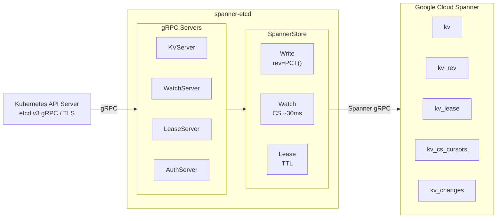
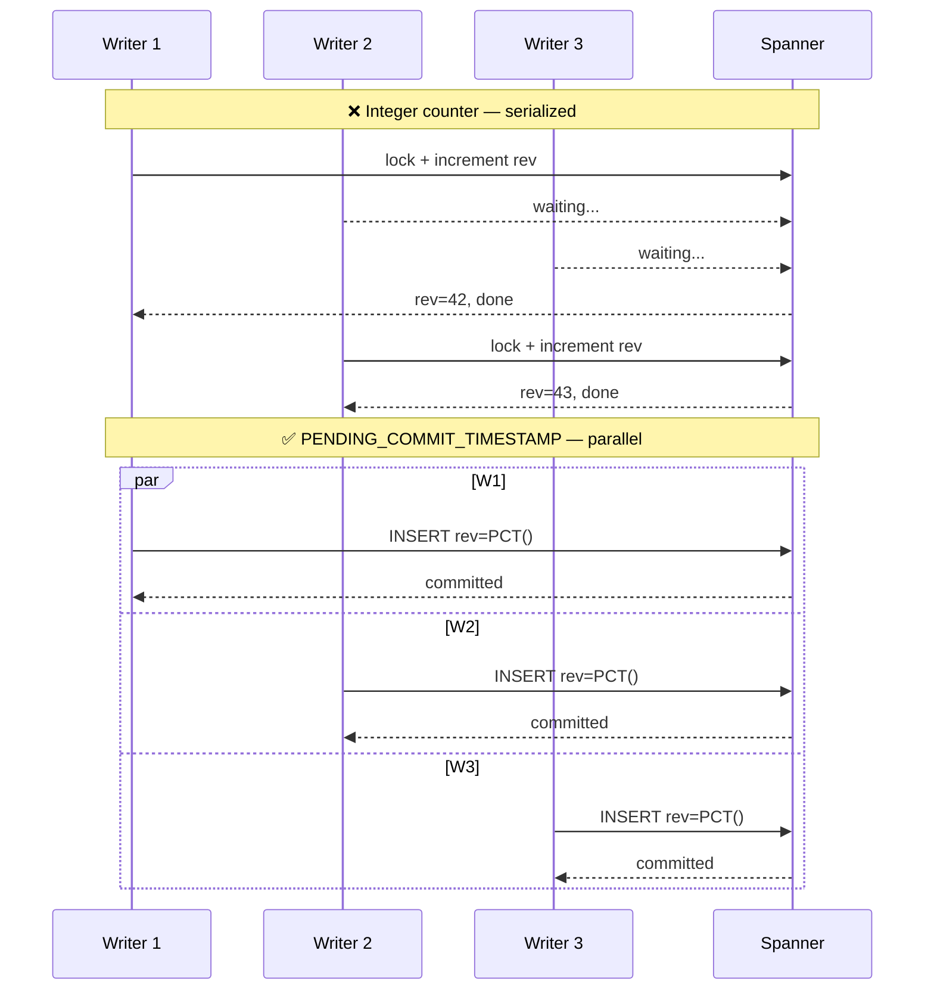
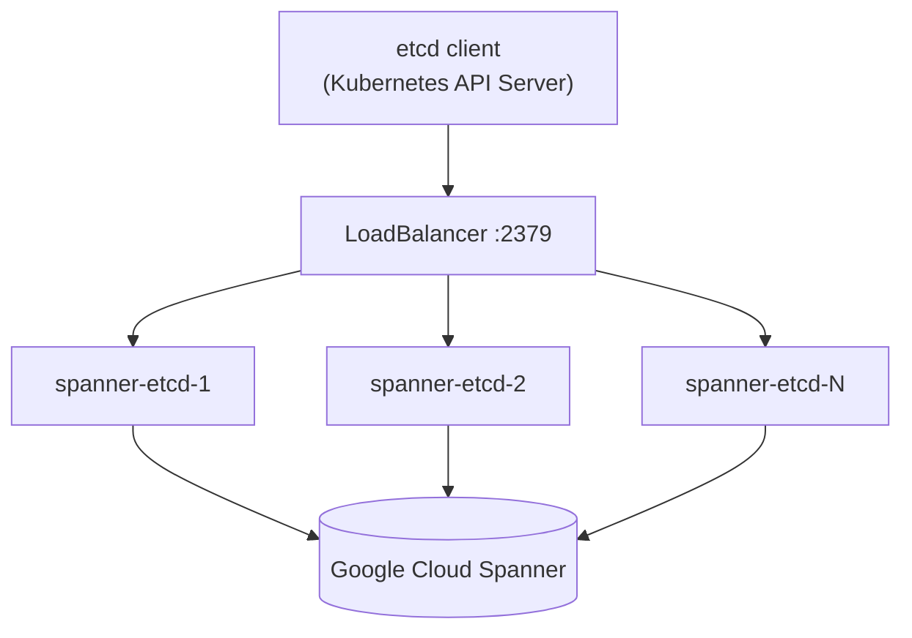

# Architecture

## Overview



Multiple `spanner-etcd` replicas can run concurrently — all state lives in Spanner. No consensus, no leader election between replicas.

## Implemented etcd v3 API

| Service | Method | Status | Notes |
|---------|--------|--------|-------|
| **KV** | Range (Get/List) | ✅ | Single key, prefix, range, historical (rev=N), count-only |
| **KV** | Put | ✅ | Create + unconditional update |
| **KV** | DeleteRange | ✅ | Single key and prefix |
| **KV** | Txn | ✅ | Compare-and-swap: MOD, VERSION, CREATE, VALUE operators |
| **KV** | Compact | ✅ | Async GC of old revisions |
| **Watch** | Watch | ✅ | Live streaming, prefix filter, revision replay, PrevKv |
| **Lease** | LeaseGrant/Revoke | ✅ | TTL leases with immediate key deletion on revoke |
| **Lease** | LeaseKeepAlive | ✅ | Bidirectional streaming keepalive; persisted, works on any replica |
| **Lease** | LeaseTimeToLive | ✅ | TTL query, answered from Spanner on any replica |
| **Auth** | Authenticate | ✅ | Username/password → token; clients auto-re-authenticate on expiry |
| **Auth** | AuthEnable/Disable/Status | ✅ | Stubs — auth controlled via `--auth-users` flag |
| **Cluster** | MemberList | ✅ | Returns self as single member |
| **Maintenance** | Status | ✅ | Returns current revision |
| gRPC Health | Check | ✅ | Standard Kubernetes liveness probe |
| gRPC Health | `/healthz` HTTP | ✅ | Kubernetes readiness/liveness probe on metrics port |

## Spanner Schema

```sql
-- See ddl/schema.sql for the full DDL.

-- rev = PENDING_COMMIT_TIMESTAMP() on every write.
-- No shared counter row, no lock — each transaction is fully independent.
CREATE TABLE kv (
  id               INT64     NOT NULL DEFAULT (GET_NEXT_SEQUENCE_VALUE(SEQUENCE kv_seq)),
  rev              TIMESTAMP NOT NULL OPTIONS (allow_commit_timestamp = true),
  key              STRING(2048) NOT NULL,
  value            BYTES(MAX),
  old_value        BYTES(MAX),
  lease_id         INT64,
  deleted          BOOL NOT NULL DEFAULT (false),
  created          BOOL NOT NULL DEFAULT (false),
  create_revision  TIMESTAMP OPTIONS (allow_commit_timestamp = true),
  prev_revision    TIMESTAMP OPTIONS (allow_commit_timestamp = true)
) PRIMARY KEY (id);

-- kv_rev stores only the compact revision (not the current revision).
-- Current revision = SELECT rev FROM kv ORDER BY rev DESC LIMIT 1
CREATE TABLE kv_rev (
  id  INT64     NOT NULL,
  rev TIMESTAMP NOT NULL
) PRIMARY KEY (id);

-- Covering index: enables index-only reads for Get/List when the optimizer chooses it.
-- STORING value/old_value doubles write amplification — see docs/performance.md.
CREATE INDEX kv_key_rev ON kv (key, rev DESC)
  STORING (value, old_value, lease_id, deleted, created, create_revision, prev_revision);

-- Descending revision index for O(1) CurrentRevision() lookup.
CREATE INDEX kv_rev_desc ON kv (rev DESC);
```

## Design Decisions

**`PENDING_COMMIT_TIMESTAMP()` as revision**: Every write sets `rev = PENDING_COMMIT_TIMESTAMP()` — Spanner's TrueTime-based commit timestamp. No shared counter row, no lock. Each transaction is fully independent. etcd clients receive `rev` as `int64` (UnixNano), which is a valid etcd `ModRevision`. This eliminates the serialization bottleneck of integer counters and provides **15× higher write throughput** at ×32 concurrency.



**`id` vs `rev`**: Physical PK (`id`) uses `bit_reversed_positive` to distribute writes across Spanner splits and avoid hotspots.

**Append-only log**: Like etcd, rows in `kv` are never updated — each write appends a new row. Compaction physically deletes old rows asynchronously.

**Watch delivery**: every event a subscriber receives comes from one ordered read of the `kv` table (`rev` greater than the last delivered revision, in revision order), so each revision is delivered exactly once and in order. Change Streams can make that read prompt: every replica follows all partitions of `kv_changes`, and a record there tells the replica to read the table now. On a real instance the record arrives either within about 15 ms of the commit or about one heartbeat interval (2 s) later, and which of the two you get varies from run to run. A write served by the replica itself wakes its own reader immediately. A timer wakes the reader every second whatever the stream does, so delivery latency is bounded by about one second and does not depend on the stream's behaviour; on the emulator, which has no Change Streams, the timer is the only mechanism. Change Stream records are deliberately not handed to subscribers: they arrive per partition and can repeat or be reordered, which would give clients duplicates and out-of-order events. Partition cursors are persisted every 5s so replicas resume from the correct position after restart.

**Leases are cluster state**: a lease is one row in `kv_lease` with an `expires_at` deadline. Grant, every keepalive and every expiry check compute time with Spanner's `CURRENT_TIMESTAMP()`, never with a replica's clock, so skew between pods cannot expire a lease early or keep it alive too long. Any replica serves Keepalive and TimeToLive for any lease. Every replica runs a reaper (about once a second) that revokes leases whose `expires_at` has passed and deletes their keys; concurrent reapers are safe because each step is idempotent and a keepalive can only extend a lease that has not expired yet, so an expired lease cannot come back. Keepalives are written on every call (not batched), so a lease lives exactly one TTL after the last keepalive, as in etcd. Rows written by versions without `expires_at` are treated as `granted_at + ttl`. A write that attaches a key to a lease (`Put`, `Txn` puts) checks inside its own transaction that the lease exists and has not expired, and fails with etcd's `requested lease not found` otherwise; without that check a key could be bound to a dead lease and never expire. Revoke and expiry scan for the lease's keys a second time after deleting the lease row to catch a write that validated the lease just before the row went away.

## Horizontal Scaling

All replicas are stateless — all state lives in Spanner.



On pod restart, Watch clients reconnect automatically via the etcd client retry logic. With `preStop: sleep 15s`, Kubernetes removes the pod from Service endpoints before SIGTERM — Watch streams migrate to surviving replicas with zero errors.

**Graceful shutdown sequence:**

```
t=0    preStop sleep (15s) — endpoint propagation
t=15s  SIGTERM → GracefulStop (10s timeout for in-flight RPCs)
t=25s  Force stop if needed; Spanner connections closed
t=60s  terminationGracePeriodSeconds — pod hard-killed by kubelet if still running
```

Tested: 45 Watch streams migrated to the surviving replica in ~10s, zero application errors.

## Known Limitations

### Auth tokens are per-replica

Auth tokens are stored in memory. A client that connected to replica-1 and switches to replica-2 receives `UNAUTHENTICATED` and re-authenticates automatically (tested with jetcd). No data is lost — only one extra round-trip on reconnect.

### Watch fan-out at extreme scale

With 10,000+ watchers and 1,000 writes/sec, the synchronous `dispatchEvents` becomes a goroutine scheduling bottleneck. Mitigation: add more replicas — each handles an independent subset of Watch connections.

### Change Streams not supported on Spanner emulator

The emulator does not support the `READ_kv_changes` TVF. spanner-etcd then relies on the 1-second poll alone: an event from a write made through another replica reaches a watcher within about a second, while a write served by the same replica wakes its watcher immediately. On a real instance the same event arrives in tens of milliseconds when the Change Stream is in its fast mode and within about a second otherwise. Measured end to end (write call to event at the subscriber, through a different replica, from a laptop over the WAN to `asia-northeast1`, 5 events per run, including the write itself): one run gave a median of 102 ms (max 207 ms), other runs on the same instance a median of about 0.7 s (max 1.5 s).

### Txn with range ops is non-atomic

Txn operations containing `RangeEnd`, `CountOnly`, `IgnoreValue`, or `IgnoreLease` fall back to a non-atomic execution path (compare and execute as separate operations). Kubernetes core operations (leader election, object CRUD) always use the atomic path. Operators and tooling using range ops in Txn work correctly but without atomicity guarantees.

### Not implemented

- Auth RBAC (UserAdd/RoleAdd/GrantPermission) — not needed for standard Kubernetes
- Defrag / Snapshot — not needed (Spanner manages storage automatically)

## Why not kine?

[kine](https://github.com/k3s-io/kine) works well with PostgreSQL and MySQL but is a poor fit for Spanner: its `generic.Dialect` assumes `MAX(id)` equals the global revision (breaks with `bit_reversed_positive` sequences), relies on `LIKE ... ESCAPE` (unsupported), and uses reserved word aliases (`AS current`, `AS compact`). Almost every query needs overriding — at which point implementing `server.Backend` directly is cleaner.
