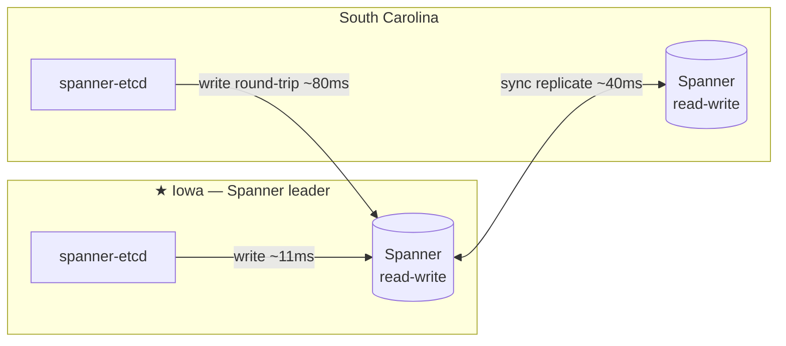

# Performance

All benchmarks run on GCP `e2-standard-4` (4 vCPU, 16GB, `us-central1-a`) against production Spanner in the same region — not the emulator.

## Write Throughput — PENDING_COMMIT_TIMESTAMP

Benchmarked with the old integer-counter baseline vs PENDING_COMMIT_TIMESTAMP:

| Clients | ops/sec | Avg latency |
|---------|---------|-------------|
| PUT ×1 | 86 | 11.7ms |
| PUT ×8 | 379 | 2.6ms |
| PUT ×32 | **673** | 1.5ms |

**vs. integer counter (same hardware):** ×1: 3.6× faster · ×8: 6.5× faster · ×32: **15× faster**

## Full Benchmark Suite — Production Spanner (us-central1, 1000 PU)

Benchmarked against a clean database. Results are averaged over 3 runs.
Covering index on `kv(key, rev DESC)` enables index-only reads when the optimizer chooses it.

| Operation | ops/sec | Avg latency | Notes |
|-----------|---------|-------------|-------|
| Create ×1 | **90** | 11.1ms | Single-key PUT |
| Create ×4 (parallel) | **270** | 3.7ms | PCT eliminates write serialization |
| Update ×1 | **88** | 11.4ms | CAS update |
| Get ×1 | **108** | 9.3ms | Single-key GET |
| Get ×4 (parallel) | **481** | 2.1ms | |
| List 100 keys | **40** | 25ms | Prefix scan, 100 results |
| Mixed ×4 (70% read / 20% write / 10% update) | **403** | 2.5ms | Kubernetes-like workload |
| Watch latency | - | **~30ms** | write and watch on the same replica (see the note on Watch latency numbers below) |

> Performance is dominated by Spanner round-trip latency (~10ms). For best results,
> run spanner-etcd in the same GCP region as your Spanner instance.

## Read Throughput (high concurrency)

| Clients | ops/sec | Avg latency |
|---------|---------|-------------|
| GET ×1 | 108 | 9.3ms |
| GET ×4 | 481 | 2.1ms |

## Spanner Processing Units — Scaling Comparison

Same VM (`us-central1-a`), clean database per run, same benchmark binary. Only Spanner PU changed.

| Operation | 100 PU | 1000 PU | 2000 PU |
|-----------|-------:|--------:|--------:|
| Create ×1 | 80 | 90 | 84 |
| Create ×4 parallel | **87** | **270** | **255** |
| Update ×1 | 65 | 88 | 84 |
| Get ×1 | 103 | 108 | 103 |
| Get ×4 parallel | 472 | 481 | 469 |
| List 100 keys | 50 | 40 | 40 |
| Mixed ×4 (70% read) | **294** | **403** | **404** |
| Watch latency | **29ms** | ~30ms | 30ms |

**Key observations:**

- **Single-key ops** are nearly identical across 1000 and 2000 PU — latency is dominated by network round-trip, not Spanner compute (Spanner CPU was at ~1% during benchmarks)
- **Parallel writes** drop significantly at 100 PU: Create ×4 falls from 270 to 87 ops/sec — the bottleneck shifts to Spanner under concurrent write load
- **Watch latency** (same-replica path, see the note below) is consistent at ~30ms across all tiers
- **100 PU is sufficient** for small Kubernetes clusters (< 100 nodes) with moderate write rates; upgrade to 1000 PU for larger clusters or sustained parallel workloads

## Multi-Region (nam6) vs Regional

`nam6` config: Iowa (×2 read-write) + South Carolina (×2 read-write) + Oregon + Los Angeles (read-only). Spanner leader resides in Iowa (`us-central1`).

Benchmarked from two VMs — one in Iowa (`us-central1-a`, same zone as leader), one in South Carolina (`us-east1-b`) — against the same `nam6` instance (1000 PU).

| Operation | Regional Iowa | nam6 Iowa | nam6 S.Carolina | nam6 S.Carolina + DR |
|-----------|-------------:|----------:|----------------:|---------------------:|
| Create ×1 | 90 | 53 | 11 | 11 |
| Create ×4 parallel | 270 | 203 | 45 | 45 |
| Update ×1 | 88 | 52 | 12 | 9 |
| Get ×1 | 108 | 116 | 14 | **16** |
| Get ×4 parallel | 481 | 577 | 60 | **64** |
| List 100 keys | 40 | 45 | 9 | **10** |
| Mixed ×4 (70% read) | 403 | 327 | 49 | **53** |
| Watch latency | ~30ms | 42ms | 131ms | 196ms |

> DR = `--spanner-read-location=us-east1` (directed reads to local replica).
> South Carolina benchmarks run on a non-empty database (~13K rows from Iowa run) — directionally correct.

**Key observations:**

- **Writes from Iowa cost ~40% more on nam6** — every write must replicate synchronously to South Carolina before committing
- **South Carolina writes are 8× slower** — Iowa→S.Carolina is ~1,500km; each write crosses that distance twice
- **Directed reads improve reads 7-14%** — reads served from local South Carolina replica instead of Iowa
- **Directed reads don't help writes or Watch** — writes always go to leader; Change Stream cursors follow the same path
- **Rule of thumb:** deploy spanner-etcd in the same region as the Spanner leader. Use `--spanner-read-location` in multi-region setups to reduce read latency from non-leader replicas.

## Kubernetes v1.33 — 24h Soak Test

**Environment:** Kubernetes v1.33.12 (kubeadm, single-node), GCP `e2-standard-4`, production Spanner `regional` 1000 PU.

**Duration:** 24 hours continuous

**Load profile:**
- Rolling deployment scaled 1–10 replicas every 2 minutes
- ConfigMap churn every 3 minutes (create + bulk delete)
- cert-manager operator running concurrently
- 57 active Watch streams throughout

**Results:**

| Metric | Value |
|--------|-------|
| Critical errors (panic / unimplemented) | **0** |
| spanner-etcd uptime | **28h** (survived full test + data collection) |
| Change Stream active | **100%** of test duration (see note below) |
| Active Watch streams | **57** stable |
| Total Txn operations | **185,952** |
| Total KV/Range operations | **237,312** |
| Auto-compaction | **140,924 rows** cleaned |
| Avg Txn latency | **~18.6ms** |
| Kubernetes node status | **Ready** throughout |

**Conclusion:** Zero crashes, zero data loss, zero unimplemented errors over 24 hours with a production Kubernetes v1.33 control plane.

> **Note on "Change Stream active".** In the version tested, that gauge was set by a timer ten seconds after startup, not by delivered records, and the Change Stream reader followed only one of the stream's initial partitions, so in practice no events arrived through the Change Stream and watches were served by the poll path (consistent with the "poll mode" observation under Production Validation below). The soak results above are valid for what they measure (stability, errors, data integrity), but they say nothing about Change Stream delivery. Both problems were fixed in v0.3.0; see the CHANGELOG.

> **Note on Watch latency numbers.** `BenchmarkWatch_Latency` and the "~30ms" figures in this document, and the multi-region Watch latency row, write and watch through the *same* replica, so they measure the local path (a local write wakes the watcher directly), not the Change Stream. For an event from a write made through *another* replica, measured against a real instance after the fix (laptop over the WAN to `asia-northeast1`, 5 events per run, write call to event at the subscriber, including the write itself), the result depends on the mode the Change Stream is in, which varies from run to run on the same instance: in its fast mode (hint about 15 ms after commit) min 85 ms, median 102 ms, max 207 ms; in its slow mode (hint one 2 s heartbeat after commit) the 1 s poll timer takes over: min 0.66 s, median 0.69 s, max 1.48 s. Before the fix such an event waited up to 30 s. Only 5 events per run were measured, so treat these as orders of magnitude, not percentiles.

## Kubernetes Workload — kubeadm v1.33.12

| Metric | Value |
|--------|-------|
| 50 Deployments created (parallel) | 3.75s |
| 100 pods Ready | 44s |
| KV/Range avg latency | ~18.6ms |

## Production Validation — GKE

Tested with **22 production Java/Kotlin microservices** (Vert.x + jetcd) on GKE:

- All services connected and loaded data from spanner-etcd on startup
- 45 active Watch streams across all services
- Auth token expiry (30s TTL) → auto-reauth with zero errors
- Pod kill → 45 Watch streams migrated to surviving replica in ~10s, zero errors
- Watch event delivery confirmed: jetcd received PUT events within ~1s (poll mode)
